# Database Schema

ResolveDesk uses PostgreSQL 16 with native JSONB support for flexible policy configurations and event payloads.

---

## ER Diagram

```mermaid
erDiagram
    BRANDS ||--o{ ORDERS_CACHE : "caches orders for"
    BRANDS ||--o{ TICKETS : "owns"
    ORDERS_CACHE ||--o{ TICKETS : "associated with"
    TICKETS ||--o{ TICKET_EVENTS : "logs"
    TICKETS ||--o{ ACTIONS : "triggers"
    TICKETS ||--o{ ESCALATIONS : "escalates to"

    BRANDS {
        bigint id PK
        text name
        text slug
        jsonb policy
        timestamptz created_at
    }

    ORDERS_CACHE {
        bigint id PK
        bigint brand_id FK
        text external_order_id
        text customer_email
        jsonb data
        timestamptz fetched_at
    }

    TICKETS {
        bigint id PK
        bigint brand_id FK
        text customer_email
        text subject
        text body
        text category
        float confidence
        text status
        bigint order_cache_id FK
        timestamptz created_at
        timestamptz updated_at
    }

    TICKET_EVENTS {
        bigint id PK
        bigint ticket_id FK
        text type
        jsonb payload
        timestamptz created_at
    }

    ACTIONS {
        bigint id PK
        bigint ticket_id FK
        text type
        jsonb payload
        timestamptz executed_at
        timestamptz created_at
    }

    ESCALATIONS {
        bigint id PK
        bigint ticket_id FK
        text reason
        jsonb context_bundle
        text assigned_to
        timestamptz resolved_at
        timestamptz created_at
    }
```



---

## Table Definitions

### 1. `brands`
Stores D2C brand metadata and JSON-based policy configurations.
- `id` (`BIGSERIAL PRIMARY KEY`): Unique brand identifier.
- `name` (`TEXT NOT NULL`): Brand name (e.g. `Acme Clothing`).
- `slug` (`TEXT NOT NULL UNIQUE`): URL/identifier slug (e.g. `acme`).
- `policy` (`JSONB`): Configuration object containing policy limits:
  ```json
  {
    "returnWindowDays": 30,
    "nonReturnableCategories": ["innerwear", "cosmetics"],
    "autoCancelBeforeShipped": true,
    "maxAutoResolveOrderValue": 3000
  }
  ```
- `created_at` (`TIMESTAMPTZ`): Record creation timestamp.

---

### 2. `orders_cache`
Stores cached snapshots of customer orders fetched from platforms (e.g. Shopify).
- `id` (`BIGSERIAL PRIMARY KEY`): Cache record ID.
- `brand_id` (`BIGINT NOT NULL REFERENCES brands(id)`): Parent brand.
- `external_order_id` (`TEXT NOT NULL`): Platform order ID (e.g. `ORD-001`).
- `customer_email` (`TEXT NOT NULL`): Email address linked to order.
- `data` (`JSONB`): Order metadata:
  ```json
  {
    "fulfillmentStatus": "shipped",
    "trackingNumber": "TRK123456",
    "deliveredAt": null,
    "category": "shoes",
    "orderValue": 1500
  }
  ```
- `fetched_at` (`TIMESTAMPTZ`): Timestamp when data was cached.
- **Constraints**: `UNIQUE (brand_id, external_order_id)`.

---

### 3. `tickets`
The central support ticket entity.
- `id` (`BIGSERIAL PRIMARY KEY`): Ticket number.
- `brand_id` (`BIGINT NOT NULL REFERENCES brands(id)`): Target brand.
- `customer_email` (`TEXT NOT NULL`): Requester email.
- `subject` (`TEXT NOT NULL`): Ticket subject.
- `body` (`TEXT NOT NULL`): Inquiry content.
- `category` (`TEXT`): Classification (`WISMO`, `RETURN`, `EXCHANGE`, `REFUND_STATUS`, `CANCELLATION`, `OTHER`).
- `confidence` (`FLOAT`): AI classifier confidence score (0.00 to 1.00).
- `status` (`TEXT NOT NULL DEFAULT 'NEW'`): `NEW`, `PROCESSING`, `AUTO_RESOLVED`, `RESOLVED`, `ESCALATED`, `CLOSED`.
- `order_cache_id` (`BIGINT REFERENCES orders_cache(id)`): Linked order cache record.
- `created_at` / `updated_at` (`TIMESTAMPTZ`).

---

### 4. `ticket_events`
Immutable audit log tracking every automated lifecycle event.
- `id` (`BIGSERIAL PRIMARY KEY`): Event ID.
- `ticket_id` (`BIGINT NOT NULL REFERENCES tickets(id)`): Parent ticket.
- `type` (`TEXT NOT NULL`): `ticket_classified`, `policy_checked`, `action_taken`, `replied`, `escalated`.
- `payload` (`JSONB`): Structured metadata associated with the event.
- `created_at` (`TIMESTAMPTZ`).

---

### 5. `actions`
Records automated actions dispatched by the system (e.g. initiating refunds, generating return labels).
- `id` (`BIGSERIAL PRIMARY KEY`): Action ID.
- `ticket_id` (`BIGINT NOT NULL REFERENCES tickets(id)`): Target ticket.
- `type` (`TEXT NOT NULL`): Action type (`REFUND`, `EXCHANGE`, `CANCEL`, `REPLY_ONLY`).
- `payload` (`JSONB`): Parameters (e.g. `amount`, `status: pending`).
- `executed_at` (`TIMESTAMPTZ`): Execution timestamp.

---

### 6. `escalations`
Human intervention queue items for tickets requiring manual review.
- `id` (`BIGSERIAL PRIMARY KEY`): Escalation ID.
- `ticket_id` (`BIGINT NOT NULL REFERENCES tickets(id)`): Flagged ticket.
- `reason` (`TEXT NOT NULL`): Human-readable trigger explanation.
- `context_bundle` (`JSONB`): Full snapshot of ticket text, classification results, and policy decision reasoning.
- `assigned_to` (`TEXT`): Agent identifier (nullable).
- `resolved_at` (`TIMESTAMPTZ`): Resolution timestamp (nullable).
